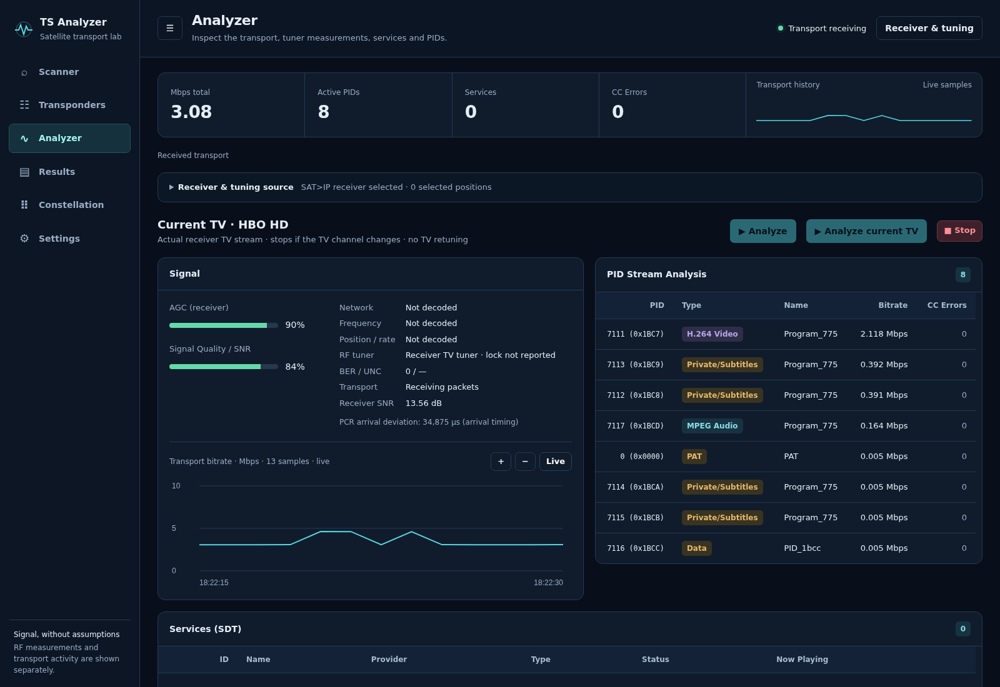
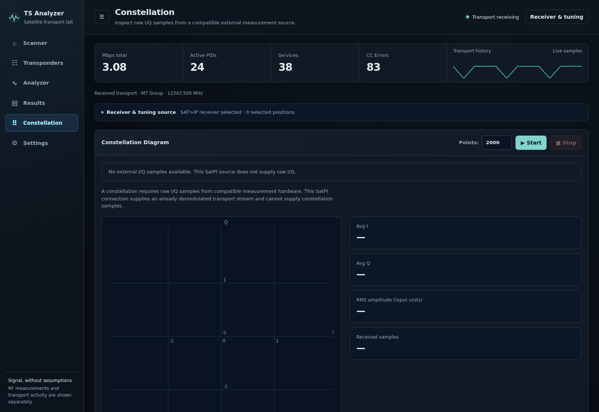

# TS Analyzer

A television stream can look unstable for several different reasons: reception, tuning, transport errors or the content being carried. TS Analyzer brings those checks into one browser workspace, helping an operator move from choosing a satellite source to inspecting the arriving stream and retaining useful findings.

The workspace keeps reception measurements separate from transport activity. An arriving stream does not automatically mean good radio reception, and an unavailable measurement stays unavailable. The featured capture shows an actual current-TV transport stream with the receiver's real SNR, AGC and error readings.

## Tech stack

| Layer | Technologies |
|---|---|
| Core stack | Rust; Python; FastAPI; JavaScript; HTML; CSS |

## Find a source and prepare a scan

Discover a SAT>IP receiver or choose one manually, then prepare the satellite positions and switch sources to investigate. Downloadable tuning lists and file imports reduce repetitive frequency entry. A filterable transponder workspace keeps frequency, polarization, symbol rate and satellite position together, so similar entries remain distinguishable.

Start a full scan or check an individual transponder. Progress, lock observations and decoded channel names help narrow the next step. Stop controls make the investigation deliberate, and reconnecting to the workspace preserves the current scan's visible progress.

## Inspect the scan results

The results workspace collects transponder observations, television services and radio services for later review. Filters help find a position or channel without reading every row. Available programme information adds context when the incoming stream carries it; missing tables do not turn into invented service names.

Saved findings can be loaded again, edited and exported as JSON for further analysis. The same workspace supports moving from a result into a closer transport inspection without re-entering its tuning details.

## Examine the transport stream

On an Enigma2 receiver, **Analyze current TV** inspects the programme already being watched without changing the TV channel. Start or stop this input directly in the workspace. If the TV channel changes, analysis stops until started again. This provides a practical single-programme view; scanning a complete satellite transponder uses the separate SAT>IP input.

Bring bitrate, active PIDs, continuity errors and timing observations together. The PID table shows the kinds of video, audio, signalling and other data actually being received. Service and programme details give those readings their content context when present in the source.

A live bitrate history supports zooming, panning and returning to the latest samples. This makes short changes easier to inspect without losing the surrounding trend. PCR arrival timing is labelled as an arrival observation, so it is not mistaken for a receiver's signal quality measurement.

## Keep reception and transport separate

When a supported receiver supplies RF measurements, inspect strength, SNR and available error readings alongside the transport observations. Each measurement has its own availability state: a missing SNR value does not hide an available strength reading, and packet activity does not manufacture a radio lock.

This separation helps identify whether the next investigation belongs at the receiving equipment or in the arriving programme transport. No-signal, missing-input and unavailable-engine states remain visible rather than leaving old values looking live.

## Inspect a real constellation source

The constellation view accepts current external I/Q samples from compatible measurement equipment. It plots the supplied samples and shows their count, average I/Q values and RMS amplitude. Without a sample source, it clearly reports missing input and leaves the measurements empty.

A standard SatPI transport stream does not provide the raw I/Q needed for this view. There is no generated constellation or artificial signal display to suggest otherwise.

## Work in a window that fits

Collapsible navigation and receiver controls leave more room for the measurements. The workspace adapts to desktop, tablet and narrow windows, while wide tables scroll within their own area. Source selection and settings remain close to the analysis without permanently taking over the screen.

Settings select the analyzer's input. Local DVB tuning is not currently implemented; the interface makes that limitation explicit instead of silently treating it as a network receiver.

---

Private code: [ts-analyzer](https://github.com/logicencoder/ts-analyzer)

See [REPOS.md](REPOS.md) for related repositories.

**[Logic Encoder](https://logicencoder.com)** · [GitHub](https://github.com/logicencoder) · [Contact](https://logicencoder.com/contact/)
